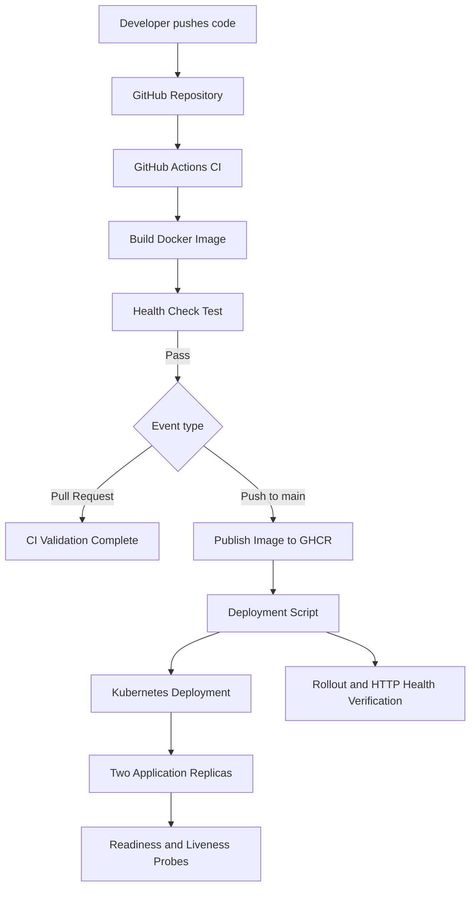

# Kubernetes Release Platform

A hands-on DevOps project that automates Docker image building, health-check testing, container image publishing, and Kubernetes application releases using GitHub Actions, Docker, and Kubernetes.

## Project Overview

This project demonstrates a basic release workflow for a containerized Nginx Service Health Dashboard. Every push to `main` triggers a CI workflow that builds the Docker image and tests its health endpoint before publishing the image to GitHub Container Registry (GHCR).

A deployment script updates the Kubernetes Deployment and verifies rollout status and application health.

## Architecture



## Technology Stack

- Docker — container packaging
- Kubernetes — application deployment and orchestration
- kind — local Kubernetes cluster
- GitHub Actions — CI automation
- GitHub Container Registry (GHCR) — image storage
- Nginx — static dashboard and health endpoint
- Bash — deployment automation

## Repository Structure

```text
.
├── .github/
│   └── workflows/
│       └── ci.yml
├── app/
│   ├── default.conf
│   └── index.html
├── k8s/
│   ├── deployment.yaml
│   └── service.yaml
├── scripts/
│   └── deploy.sh
├── Dockerfile
└── README.md
```

## CI/CD Workflow

The GitHub Actions workflow:

1. Checks out the source code.
2. Builds the Docker image.
3. Starts a test container.
4. Checks the `/health` endpoint.
5. Publishes the image to GHCR on pushes.
6. Creates a commit-specific image tag and updates `latest` on pushes to `main`.

Pull requests run build and health-check validation without publishing the image.

## Kubernetes Deployment

The application runs in the `release-platform` namespace.

- Deployment: `service-health-dashboard`
- Replicas: 2
- Service type: ClusterIP
- Container port: 80
- Health endpoint: `/health`
- Probes: readiness and liveness
- Resource requests and limits: configured in the Deployment manifest

## Deploy an Image

Prerequisites: `kubectl`, a running Kubernetes cluster, and access to the published container image.

From the project root:

```bash
chmod +x scripts/deploy.sh
./scripts/deploy.sh latest
```

For a commit-specific release, use an actual published tag:

```bash
./scripts/deploy.sh sha-<actual-7-character-commit-sha>
```

Replace the placeholder with a real tag available in GHCR.

The script updates the Deployment, waits for the rollout, forwards the Service port locally, and checks the health endpoint.

## Verify the Deployment

Check Deployment status:

```bash
kubectl get deployment service-health-dashboard -n release-platform
```

Check Pods and Service:

```bash
kubectl get pods -n release-platform
kubectl get service service-health-dashboard -n release-platform
```

Inspect rollout history:

```bash
kubectl rollout history deployment/service-health-dashboard -n release-platform
```

Check application health manually:

```bash
kubectl port-forward -n release-platform \
  service/service-health-dashboard 18081:80
```

In a second terminal:

```bash
curl --fail http://127.0.0.1:18081/health
```

Stop port forwarding with `Ctrl+C` when finished.

## Engineering Practices Demonstrated

- Automated Docker image builds
- Health-check-based CI validation
- Commit-specific container image tagging
- Container registry publishing
- Kubernetes rolling deployments
- Readiness and liveness probes
- Resource requests and limits
- Deployment rollout verification
- Scripted post-deployment health checks

## Future Improvements

- Validate that a container image exists before changing the live Deployment.
- Add automated rollback on failed health checks.
- Deploy using GitHub Actions with secure authentication.
- Add image vulnerability scanning and software supply-chain controls.
- Add staging and production environments with approval gates.

## Project Goal

Demonstrate a practical release workflow that connects source control, container builds, image publishing, Kubernetes deployment, and post-release verification in one reproducible project.

**Repository:** https://github.com/maruti1828/kubernetes-release-platform
